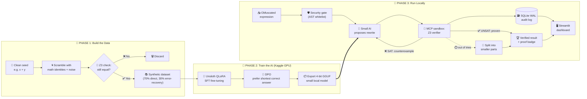

# 🧬 PALIMPSEST

### 🤖 The AI Proposes. 🧮 The Math Proves.

**Built by Team NEXUS** 💫

> An **offline, self-correcting AI system** that un-scrambles obfuscated code and gives a **mathematical proof** that its answer is correct. No cloud. No guessing. No hallucinations in the final output.


---

## 📖 Table of Contents

- [💡 The Big Idea](#-the-big-idea)
- [😵 The Problem](#-the-problem)
- [✨ Our Solution](#-our-solution)
- [🎬 See It in Action](#-see-it-in-action)
- [🏗️ How It Works](#️-how-it-works)
- [🧭 Workflow Architecture](#-workflow-architecture)
- [🧪 Where Our Training Data Comes From](#-where-our-training-data-comes-from)
- [🧠 How We Trained the AI](#-how-we-trained-the-ai)
- [🛠️ Tools We Used](#️-tools-we-used)
- [📚 Concepts Explained Simply](#-concepts-explained-simply)
- [🆚 Why PALIMPSEST Is Different](#-why-palimpsest-is-different)
- [🚀 Getting Started](#-getting-started)
- [👥 Team](#-team)

---

## 💡 The Big Idea

Imagine someone takes the simple sum `x + y` and disguises it as a **300-character monster** full of weird symbols. Humans can't read it. Normal tools give up on it.

**PALIMPSEST** reads that monster and tells you:

> ✅ "This is just `x + y`. And here is a **mathematical proof** that I'm right."

We do this by splitting the work between two partners:

| 🤖 The AI (small local model) | 🧮 The Math (Z3 solver) |
| --- | --- |
| Fast, intuitive, makes smart guesses | Slow-thinking, strict, never wrong |
| Can make mistakes | Checks every guess with proof |
| **Proposes** an answer | **Proves or rejects** the answer |

If the math says "wrong", it also tells the AI **exactly where it failed**, and the AI tries again. 🔁

---

## 😵 The Problem

Malware writers and software-protection tools **scramble code on purpose** so nobody can understand what it does. Three popular tricks:

| 🎭 Trick | 🧒 Simple Explanation |
| --- | --- |
| **MBA (Mixed Boolean-Arithmetic)** | Hide a simple calculation like `x + y` inside a pile of mixed bit-operations and math that all secretly cancel out |
| **Opaque Predicates** | Add `if` checks that *look* unpredictable but always give the same answer, so fake code paths waste your time |
| **Control-Flow Flattening** | Take a neat program and chop it into hundreds of disconnected blocks controlled by a giant `switch`, so you can't see the flow |

### 😬 Why existing tools struggle

- 🔧 **Decompilers (Ghidra, IDA Pro):** use fixed hand-written rules. Change the disguise slightly and the rules stop matching.
- 🧮 **Math solvers alone (Z3, Angr):** great at *checking* if two expressions match, terrible at *finding* the simple one. It's like a judge who can verify an answer but can't solve the puzzle.
- ☁️ **Big cloud AIs (GPT, Claude, Gemini):**
  - 🔒 You can't upload live malware or secret firmware to a third-party server.
  - 🎲 They guess, and one wrong bit ruins the whole analysis.
  - 🐢 Hundreds of back-and-forth calls over the internet is painfully slow.

---

## ✨ Our Solution

PALIMPSEST stands on **three pillars**:

### 1️⃣ 🤝 The AI Proposes, The Math Proves
A small fine-tuned AI quickly suggests a simpler version. The **Z3 theorem prover** then checks whether it is *identical* to the original for **every possible 64-bit input** (that's more combinations than there are grains of sand on Earth, checked in milliseconds ⚡).

### 2️⃣ 🔁 Learn From Mistakes (CEGIS Loop)
If the AI is wrong, Z3 doesn't just say "no". It hands back a **counterexample**, the exact input where the two versions disagree. The AI reads this evidence and fixes its answer. This repeats until the math says ✅.

### 3️⃣ 🔒 100% Local and Zero-Trust
Everything runs **on a single laptop**, offline. Tools are locked inside safe sandboxes so dangerous code in a malware sample can never run on your machine.

---

## 🎬 See It in Action

**🕵️ An analyst finds this scrambled expression in a suspicious file:**

```
((((~(~x)) ^ y) + 2 * ((~(~x)) & y))) + (((x | y) - (x ^ y)) - (x & y))
```

**🔁 What PALIMPSEST does:**

| Step | What happens | Result |
| --- | --- | --- |
| 1️⃣ | 🛡️ Safety gate checks the input is pure math (no hidden commands) and counts its size | 38 nodes |
| 2️⃣ | 🤖 AI's first guess: `x ^ y` | Close, but it forgot the carry! |
| 3️⃣ | 🧮 Z3 says **❌ WRONG** and shows: `x = 1, y = 1` → original gives `2`, guess gives `0` | ~11 ms |
| 4️⃣ | 🤖 AI reads that evidence and tries again: `x + y` | |
| 5️⃣ | 🧮 Z3 says **✅ PROVEN EQUIVALENT** | ~8 ms |

**🏁 Final output:**

```
✅ Z3 FORMAL EQUIVALENCE PROVEN
Original : 38 nodes
Simplified: x + y  (3 nodes)
Reduction : 92.1%
Cloud API calls: 0
```

---

## 🏗️ How It Works

PALIMPSEST is a **loop**, not a straight line. It keeps going until the math is satisfied.

```
        📥 Obfuscated Expression
                  │
                  ▼
   🛡️ NODE 1: Security Gate (AST check)
                  │
                  ▼
   ┌─► 🤖 NODE 2: Small AI proposes a simpler version
   │              │
   │              ▼
   │   🧮 NODE 3: Z3 tries to find a counterexample
   │              │
   │      ┌───────┴────────┐
   │   ❌ SAT           ✅ UNSAT
   │  (found a bug)    (proven identical)
   │      │                │
   └──────┘                │
 (send the bug back        │
  to the AI)               │
                           │      ⏱️ Out of tries?
                           │            │
                           │            ▼
                           │   🧩 NODE 4: Split into smaller
                           │      pieces, solve each one
                           │            │
                           ▼            ▼
              🏆 NODE 5: Verified answer + proof badge
```

### 🧩 What each node does

| Node | Job |
| --- | --- |
| 🛡️ **1. Security Gate** | Parses the input and only allows pure math/bit operators. Function calls, imports, and shell tricks are rejected instantly |
| 🤖 **2. AI Proposer** | Suggests a simpler expression. On retries, it sees every past failed guess and its counterexample |
| 🧮 **3. Z3 Verifier** | Proves the guess is equal to the original, or finds an input where it isn't |
| 🧩 **4. Fallback** | If the full expression is too hard, breaks it into small sub-parts and verifies each one |
| 🏆 **5. Output** | Shows the verified result, how much it shrank, solve time, and the full step-by-step trace |

---

## 🧭 Workflow Architecture

The whole project has **3 phases**. Phases 1 and 2 happen once (building the AI). Phase 3 is what runs every time an analyst uses the tool.



### 🔎 How the pieces connect

| Phase | Input | What happens | Output |
| --- | --- | --- | --- |
| 🧪 **1. Data** | Clean expressions | Scramble automatically, keep only pairs Z3 proves equal | Verified training dataset |
| 🧠 **2. Training** | Dataset | SFT teaches the patterns, DPO teaches "shortest correct wins" | Small local GGUF model |
| 🚀 **3. Runtime** | Obfuscated expression | AI proposes, Z3 checks, counterexamples loop back until proven | Simple expression + proof |

### 🔐 Layers of safety

1. 🛡️ **Before the AI:** the AST gate rejects anything that isn't pure math.
2. 📦 **During verification:** Z3 runs in a sandbox with a strict time limit (about 3 seconds).
3. 🧮 **After the AI:** nothing is accepted unless Z3 proves it. The AI's guess alone is never trusted.
4. 🗃️ **Always:** every step is logged to SQLite for auditing.

---

## 🧪 Where Our Training Data Comes From

> 🤔 **Problem:** Where do you get thousands of correctly labeled obfuscated expressions? Hiring experts to label malware takes forever.

> 💡 **Our trick: the "Trapdoor"**

Scrambling code is **easy**. Unscrambling is **hard**. So we cheat:

1. 🌱 Start with a **simple, clean** expression like `x + y`.
2. 🌀 **Scramble it automatically** using math identities (easy and fast).
3. 🔄 **Flip the pair around**: the scrambled version becomes the *question*, the clean version becomes the *answer*.

Result: unlimited training data that is **automatically correct**, with **zero human labeling** and **zero cloud cost**. 🎉

### 🏭 Our 4-stage data factory

| Stage | What happens |
| --- | --- |
| 🌱 **1. Seed** | Pick a clean expression (`x + y`, `x ^ y`, `(x & y) + z`, ...) |
| 🔁 **2. Substitute** | Replace parts with equivalent-but-messier math identities, several layers deep |
| 🧨 **3. Add noise** | Inject "opaque zeros" (terms that secretly always equal 0) to mimic real obfuscators like Tigress and OLLVM |
| ✅ **4. Verify** | Z3 double-checks every pair. Anything not provably equal is thrown away |

### 🎓 We also teach the AI how to recover from mistakes

- **70% of examples:** Scrambled expression → correct simple answer.
- **30% of examples:** Scrambled expression + a *wrong guess* + Z3's counterexample → corrected answer.

That second group is what teaches the AI to **read Z3's feedback** instead of panicking. 🧘

---

## 🧠 How We Trained the AI

We use a **small 3-billion-parameter model** (Qwen-2.5-Coder-3B or Llama-3.2-3B) instead of a giant one.

### 🤷 Why small is better here
This is a narrow, rule-based task with only about 10 operators. A big general model knows poetry and history, which we don't need. A small specialist is:

- ⚡ **Fast:** answers in under ~150 ms
- 💾 **Tiny:** under ~2.5 GB when compressed
- 💻 **Laptop-friendly:** no data center needed

### 🏋️ The two training steps

| Step | Tool/Method | Plain-English meaning |
| --- | --- | --- |
| **1. SFT** (Supervised Fine-Tuning) | Unsloth + 4-bit QLoRA | Show the model thousands of "scrambled → clean" examples until it learns the patterns |
| **2. DPO** (Direct Preference Optimization) | Preference pairs | Teach it to **prefer** the shortest correct answer over a longer correct one, and never the wrong one |

Example of what DPO teaches:

- ✅ `x + y` → correct and smallest → **best**
- 🟡 `(x | y) + (x & y)` → correct but bloated → **okay**
- ❌ `x ^ y` → incorrect → **worst**

Training runs on a **free Kaggle GPU (T4/P100)**, then the model is exported as a compact **GGUF (q4_k_m)** file for local use. 📦

---

## 🛠️ Tools We Used

| Tool | 🎯 What it does for us |
| --- | --- |
| 🧮 **Microsoft Z3** | The "math judge". Proves two expressions are equal for all possible inputs (QF_BV bit-vector logic) |
| 🕸️ **LangGraph** | Builds our agent as a **loop** that retries until Z3 is happy |
| 🔌 **MCP (Model Context Protocol)** | Lets the AI use tools (like Z3) safely, inside isolated sandboxes |
| 🦥 **Unsloth** | Makes fine-tuning ~2x faster and uses far less GPU memory |
| 🤗 **Qwen-2.5-Coder-3B / Llama-3.2-3B** | The small base AI models we specialize |
| 🧬 **QLoRA** | Trains only a small add-on to a compressed model, so it fits on a free GPU |
| 🎯 **DPO** | Aligns the model to prefer simple, correct answers |
| 🐍 **Python `ast` module** | Safely parses expressions and enforces our "math only" whitelist |
| 🗃️ **SQLite (WAL mode)** | Fast audit log of every step, without slowing down the UI |
| 🖥️ **Streamlit** | The "Command Center" dashboard to paste expressions and watch the loop live |
| 📊 **Kaggle GPU** | Free GPU used for training |
| 📦 **GGUF (q4_k_m)** | Compact model format for fast local inference |

---

## 📚 Concepts Explained Simply

<details>
<summary>🔢 <b>MBA (Mixed Boolean-Arithmetic)</b></summary>

Computers have two "languages" of operations: **bit tricks** (`&`, `|`, `^`, `~`) and **normal math** (`+`, `-`, `*`). Mixing them creates expressions that are very hard to read, even though they can equal something simple.

Example: `(x ^ y) + 2 * (x & y)` is really just `x + y`. 🪄
</details>

<details>
<summary>🎭 <b>Obfuscation</b></summary>

Deliberately making code confusing so humans and tools can't understand it. Used by malware authors and by copy-protection software.
</details>

<details>
<summary>✅ <b>SMT Solver / Z3</b></summary>

A program that answers: "Is there *any* input that breaks this statement?" If it says **no**, the statement is proven true for every input. That is a real mathematical guarantee, not a test.
</details>

<details>
<summary>🔍 <b>UNSAT vs SAT</b></summary>

- **UNSAT** = "No counterexample exists" → ✅ **Proven equal**
- **SAT** = "Here's an input where they differ" → ❌ **Not equal** (and here's the proof)
</details>

<details>
<summary>⚖️ <b>Miter Circuit</b></summary>

Feed the same input into both expressions, compare the outputs, and ask Z3: *"Can the outputs ever differ?"* If the answer is no, they are identical.
</details>

<details>
<summary>🔁 <b>CEGIS (Counterexample-Guided Inductive Synthesis)</b></summary>

A fancy name for **guess → test → learn from the failure → guess again**. Like a student getting a graded exam back with the exact mistakes circled. 📝
</details>

<details>
<summary>🧠 <b>SLM (Small Language Model)</b></summary>

A compact AI model (here ~3 billion parameters). Less general knowledge than giant models, but fast, private, and cheap, and when fine-tuned for one task it can excel at it.
</details>

<details>
<summary>🎛️ <b>Fine-tuning, LoRA and QLoRA</b></summary>

- **Fine-tuning:** teaching an existing model a new specialty.
- **LoRA:** instead of rewriting the whole model, train a few small "add-on" layers.
- **QLoRA:** same thing, but the base model is compressed to 4-bit first so it fits on small GPUs.
</details>

<details>
<summary>🏆 <b>DPO (Direct Preference Optimization)</b></summary>

Show the model pairs of "better answer" vs "worse answer" so it learns what we *prefer*. Here: prefer **correct and shortest**.
</details>

<details>
<summary>🔄 <b>Why LangGraph (and not a normal chain)?</b></summary>

Normal pipelines only go forward (A → B → C). We need to **loop back** when Z3 rejects an answer. LangGraph is built for stateful loops with clear rules for when to stop.
</details>

<details>
<summary>🔌 <b>MCP (Model Context Protocol)</b></summary>

A standard way for AI to call tools. We use it so the AI never runs dangerous code directly. Tools live in sandboxes with strict timeouts.
</details>

<details>
<summary>📝 <b>SQLite WAL Mode</b></summary>

A database setting that lets us **write logs and read the dashboard at the same time** without blocking each other.
</details>

<details>
<summary>🚧 <b>Control-Flow Flattening and Opaque Predicates</b></summary>

- **Control-Flow Flattening:** a neat program turned into a messy `switch` loop.
- **Opaque Predicate:** an `if` condition that's secretly always true (or always false), used to hide fake code.
</details>

---

## 🆚 Why PALIMPSEST Is Different

| 🔍 Dimension | 🙄 Typical AI Wrapper | 🚀 PALIMPSEST |
| --- | --- | --- |
| **Role of AI** | Chatbot that guesses | Small specialist **inside a proof loop** |
| **Trust in output** | "Looks right" 🤞 | **Z3-proven** across all 64-bit inputs ✅ |
| **Training data** | Scraped or none | **Self-generated, auto-verified** (Trapdoor engine) |
| **Fine-tuning** | None | **Unsloth QLoRA + DPO** |
| **Agent design** | Straight prompt chain | **Cyclical LangGraph loop** using counterexamples |
| **Privacy** | Sends data to cloud APIs ☁️ | **100% offline, sandboxed** 🔒 |
| **Speed** | Seconds per round-trip | **Milliseconds** per check ⚡ |

---

## 🚀 Getting Started

> ✏️ **Team: fill in the exact commands for your repo!**

```bash
# 1. Clone the repo
git clone https://github.com/<your-username>/<your-repo>.git
cd <your-repo>

# 2. Install dependencies
pip install -r requirements.txt

# 3. Download / place the fine-tuned GGUF model
#    (add link or instructions here)

# 4. Launch the Command Center
streamlit run app.py
```

Then paste an obfuscated expression and watch PALIMPSEST work. ✨

---

## 👥 Team NEXUS

| 👤 Members |
| --- |
| Suriya |
| Krishitha |
| Kaniska |
| Anbukumaran |
| Nahulan |

---

## 📜 License

This project is licensed under the **Apache License 2.0**. See the [LICENSE](LICENSE) file for details.

In short: you can use, modify and share this project (even commercially), as long as you keep the license and copyright notice. ✅

---

<p align="center">
  <b>🧬 PALIMPSEST: because "trust me" isn't a proof.</b> 🧮
</p>
