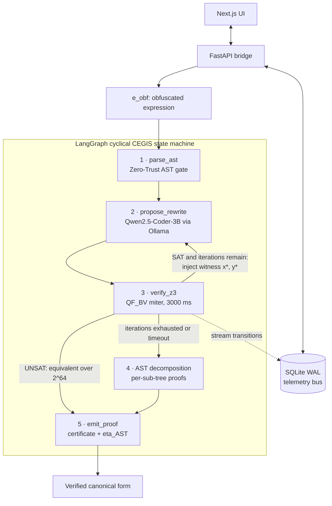
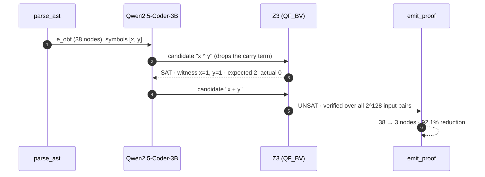
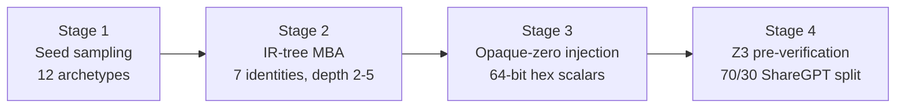

<div align="center">

<!-- VISUAL ANCHOR 1: Hero banner. Recommended: 1280×320 SVG/PNG, dark background, wordmark + tagline. -->


# PALIMPSEST

### Formally verified MBA de-obfuscation. A 3B model proposes. Z3 proves.

**Codename `VEX-MORPH` · Air-gapped · Neurosymbolic · Bit-exact over 64-bit registers**

[](https://github.com/anbukumaran1/palimpsest-vex-morph/actions)
[](https://codecov.io/gh/anbukumaran1/palimpsest-vex-morph)
[](https://github.com/anbukumaran1/palimpsest-vex-morph/releases)
[](LICENSE)

[](https://python.org)
[](https://github.com/Z3Prover/z3)
[](https://huggingface.co/Qwen)
[](https://github.com/unslothai/unsloth)
[](https://github.com/langchain-ai/langgraph)
[-F43F5E?style=flat-square)](#zero-trust-security-model)

[Quick Start](#quick-start) · [Architecture](#architecture) · [Usage](#usage-examples) · [Configuration](#configuration-reference) · [Contributing](#contributing)

<!-- VISUAL ANCHOR 2: Terminal demo. Record with `vhs` or `asciinema` + `agg`. Show: obfuscated input → SAT witness → corrected proposal → UNSAT proof. -->


</div>

---

## Overview

**PALIMPSEST** collapses Mixed Boolean-Arithmetic (MBA) obfuscation into its minimal canonical form and **proves** the result is bit-for-bit equivalent over every possible 64-bit register state.

A fine-tuned 3B small language model proposes simplifications. Microsoft Z3 verifies each one in `QF_BV`. When the model is wrong, Z3 returns the exact counterexample, and the model uses it to self-correct. Nothing leaves your machine.

> [!IMPORTANT]
> **The AI proposes. The math proves.** An answer is emitted only after Z3 returns `UNSAT` on the negated miter. The model never has the last word.

### The problem

Malware authors, APTs, and DRM engines hide logic behind MBA expressions, opaque predicates, and control-flow flattening. Interleaving arithmetic (`+ - *`) with bitwise operators (`^ & | ~ << >>`) over $\mathbb{Z}_{2^{64}}$ turns a 3-node `x + y` into a 139-node expression.

Current tooling breaks in three distinct ways:

| Approach | Examples | Failure mode on nested 64-bit MBA |
| :--- | :--- | :--- |
| **Static decompilers** | Ghidra, IDA Pro, Binary Ninja | Hardcoded peephole rewrite rules. Adversaries nest polynomial MBA identities and inject hex-scaled opaque zeros faster than rules can be written. |
| **Standalone SMT / symbolic engines** | `Z3.simplify()`, angr, Triton | Synthesizing a minimal equivalent from scratch over 64-bit bit-vectors triggers state-space explosion. |
| **Cloud LLMs** | GPT-4o, Claude 3.5 Sonnet | Sending binary slices to external APIs breaks air-gap requirements. Models also miscompute carries, two's-complement wrap-around, and operator precedence, with no formal guarantee. |

### The approach

PALIMPSEST does not ask a solver to *search* an infinite synthesis space. It does not trust a model to be right. It runs a **Counterexample-Guided Inductive Synthesis (CEGIS)** loop that separates the two jobs:

| Pillar | Component | Role |
| :---: | :--- | :--- |
| **1** | `Qwen2.5-Coder-3B-Instruct` (Unsloth QLoRA + DPO, GGUF `q4_k_m`, served by Ollama) | Amortized proposal distribution $P_\theta(e' \mid e_{\text{obf}})$. Collapses large AST trees in one forward pass. |
| **2** | Z3 `QF_BV` inside an isolated MCP sandbox | Decides equivalence over all $2^{64}$ states per variable. Compiles ASTs to `z3.BitVec` natively, with **zero `eval()`**. |
| **3** | LangGraph cyclical state machine | Routes Z3 witnesses back to the model, falls back to sub-tree decomposition, and emits the proof certificate. |

---

## Key Features

<table>
<tr>
<td width="50%" valign="top">

**Formal guarantee**
`UNSAT` on the negated miter proves $e_{\text{obf}}(\mathbf{x}) = e'(\mathbf{x})$ for **every** 64-bit input. Success emits `QF_BV_UNSAT_64BIT_VERIFIED`.

</td>
<td width="50%" valign="top">

**Air-gapped by design**
Local 3B model, local solver, local telemetry. No network calls. Fits inside a **< 2.5 GB VRAM** budget.

</td>
</tr>
<tr>
<td valign="top">

**Self-correcting CEGIS loop**
A `SAT` result yields a concrete witness `(x*, y*, expected, actual)`. The witness conditions the next proposal.

</td>
<td valign="top">

**Hardware-faithful semantics**
Models registers as $\mathbb{Z}_{2^{64}}$ with `z3.BitVec(v, 64)`. Wrap-around and two's-complement identities such as $-x \equiv \sim x + 1$ hold exactly. `z3.Int` cannot represent them.

</td>
</tr>
<tr>
<td valign="top">

**Zero-trust expression handling**
Static AST whitelist rejects `Call`, `Attribute`, `Import`, and `__builtins__` in **< 50 µs**. A native AST-to-Z3 compiler removes `eval()` and `exec()` entirely.

</td>
<td valign="top">

**Graceful degradation**
On solver timeout or exhausted iterations, the engine decomposes the AST bottom-up and proves each sub-tree independently.

</td>
</tr>
<tr>
<td valign="top">

**Trapdoor Inverse dataset engine**
Reversing MBA is hard. *Generating* it is $O(d)$. A 4-stage generator emits Z3-verified SFT and CEGIS-recovery traces in ShareGPT format.

</td>
<td valign="top">

**Edge-native inference**
`q4_k_m` GGUF on Ollama delivers **< 150 ms** per proposal. A full 2-hop correction cycle completes in about 216 ms in the reference run.

</td>
</tr>
</table>

---

## Quick Start

Run the full verification stack in under 60 seconds.

**Prerequisites:** Python 3.11+, Git.

```bash
git clone https://github.com/anbukumaran1/palimpsest-vex-morph.git
cd palimpsest-vex-morph/training

python3 -m venv .venv
source .venv/bin/activate          # Windows: .venv\Scripts\activate
pip install -r requirements.txt

python z3_verifier.py
```

Expected output (hex constants and node counts vary per run):

```text
Obfuscated MBA String:
((((((((x) ^ (y))) + (((0xccea71ff4a14876a) * (((((x) & ((~(x))))) * (y))))))) | ... 
AST Node Count: 77
Verification Result:
{'status': 'QF_BV_UNSAT_64BIT_VERIFIED', 'latency_ms': 35.048}
```

> [!TIP]
> Skip ahead to [Prove It Yourself](#prove-it-yourself-standalone-z3-miter) for a 15-line script that reproduces the core idea with nothing but `z3-solver`.

---

## Architecture

### System topology



### Node responsibilities

| Node | Name | Responsibility |
| :---: | :--- | :--- |
| **1** | `parse_ast` | Enforce the AST whitelist (`< 50 µs`). Extract 64-bit register symbols. Compute the baseline node count $\lvert\text{Nodes}(e_{\text{obf}})\rvert$. |
| **2** | `propose_rewrite` | Iteration 1: sample a minimal candidate $e'_1$. Iteration $k>1$: condition on the Z3 witness `(x*, y*, y_expected, y_actual)`. |
| **3** | `verify_z3` | Compile the AST to native `z3.BitVec(v, 64)`. Solve the negated miter under a `3000 ms` timeout. Stream the transition to the telemetry bus. |
| **4** | AST decomposition | Slice child sub-trees bottom-up. Prove each independently. Runs on timeout or when `max_iterations` is exhausted. |
| **5** | `emit_proof` | Emit `QF_BV_UNSAT_64BIT_VERIFIED`. Compute $\eta_{\text{AST}} = 1 - \lvert\text{Nodes}(e')\rvert / \lvert\text{Nodes}(e_{\text{obf}})\rvert$. |

### Live 2-hop walkthrough

Input: a 38-node expression mixing linear bit-identities with an injected opaque zero.

```python
e_obf = "((((~(~x)) ^ y) + 2 * ((~(~x)) & y))) + (((x | y) - (x ^ y)) - (x & y))"
```



| Step | Component | Outcome | AST nodes | Latency |
| :---: | :--- | :--- | :---: | :---: |
| 1 | `parse_ast` | Whitelist passed. Symbols `['x', 'y']`. | 38 | 0.03 ms |
| 2 | `propose_rewrite` (iter 1) | Proposes `x ^ y`. Misses `2 * (x & y)`. | 3 | 94.2 ms |
| 3 | `verify_z3` (iter 1) | **`SAT`**. Witness `x=1, y=1`, expected `2`, actual `0`. | — | 11.4 ms |
| 4 | `propose_rewrite` (iter 2) | Ingests witness. Self-corrects to `x + y`. | 3 | 102.6 ms |
| 5 | `verify_z3` (iter 2) | **`QF_BV_UNSAT_64BIT_VERIFIED`** | 3 | 8.2 ms |
| 6 | `emit_proof` | Emits `x + y`. **92.1% node reduction.** | **3** | **216.4 ms total** |

---

## How It Works: Formal Specification

### Why `QF_BV` and not `z3.Int`

CPU registers are not mathematical integers. They are elements of the finite ring $\mathbb{Z}_{2^{64}}$. Arithmetic wraps modulo $2^{64}$, and bitwise operators act on two's-complement bit arrays. Identities such as $-x \equiv \sim x + 1$ hold in that ring but not in $\mathbb{Z}$. PALIMPSEST therefore models every symbol $v$ as:

$$\mathbf{x} = (x_1,\dots,x_m) \in \left(\{0,1\}^{64}\right)^m \quad\text{via}\quad \texttt{z3.BitVec(v, 64)}$$

### The negated miter

For a candidate $e'$, the engine builds

$$\Phi(\mathbf{x}) \iff e_{\text{obf}}(x_1,\dots,x_m) \neq e'(x_1,\dots,x_m)$$

and asks Z3 for satisfiability under $T_{\max} = 3000\ \text{ms}$.

| Result | Meaning | Engine action |
| :---: | :--- | :--- |
| **`UNSAT`** | No input distinguishes the expressions, so $\forall\mathbf{x}:\ e_{\text{obf}}(\mathbf{x}) = e'(\mathbf{x})$. | Emit `QF_BV_UNSAT_64BIT_VERIFIED`. |
| **`SAT`** | A witness $\mathbf{x}^*$ exists. Compute $y_{\text{expected}} = e_{\text{obf}}(\mathbf{x}^*)$ and $y_{\text{actual}} = e'(\mathbf{x}^*)$. | Route $(\mathbf{x}^*, y_{\text{expected}}, y_{\text{actual}})$ to Node 2. |
| **`UNKNOWN` / timeout** | The solver exhausted its budget. | Fall through to AST decomposition (Node 4). |

---

## Usage Examples

### Prove it yourself: standalone Z3 miter

This script reproduces the core mechanism with only `z3-solver`. It works as a sanity check for your environment.

```python
import z3

x, y = z3.BitVec("x", 64), z3.BitVec("y", 64)

# 38-node MBA expression from the walkthrough
e_obf = (((~(~x)) ^ y) + 2 * ((~(~x)) & y)) + (((x | y) - (x ^ y)) - (x & y))


def miter(candidate: z3.BitVecRef, timeout_ms: int = 3000) -> dict:
    """Solve the negated miter: SAT means the candidate is wrong."""
    solver = z3.Solver()
    solver.set("timeout", timeout_ms)
    solver.add(e_obf != candidate)
    result = solver.check()

    if result == z3.unsat:
        return {"status": "QF_BV_UNSAT_64BIT_VERIFIED"}
    if result == z3.sat:
        m = solver.model()
        xv, yv = m.eval(x, True).as_long(), m.eval(y, True).as_long()
        return {
            "status": "SAT",
            "witness": {"x": hex(xv), "y": hex(yv)},
            "expected": hex(m.eval(e_obf, True).as_long()),
            "actual": hex(m.eval(candidate, True).as_long()),
        }
    return {"status": "UNKNOWN_TIMEOUT"}


print(miter(x ^ y))   # SAT: carry bits collide, returns a concrete witness
print(miter(x + y))   # QF_BV_UNSAT_64BIT_VERIFIED
```

### Run the pipeline components

```bash
cd training

python ast_slicer.py                       # Zero-Trust AST gate self-test
python mba_mutator.py                      # Depth-4 IR-tree MBA mutation
python z3_verifier.py                      # Native AST → Z3 64-bit miter proof
python dataset_generator.py --rows 100     # Multi-core SFT + CEGIS trace generation
```

Expected outputs:

```text
# ast_slicer.py
Valid expression node count: 13
Rejected as expected

# mba_mutator.py
Original Seed: x + y
Original AST Node Count: 4
Mutated MBA String: ((((((((((x) ^ (y))) ^ ... (truncated)
Mutated AST Node Count: 139

# dataset_generator.py
Starting multi-core generation: 100 rows using 16 workers...
[Progress] 100/100 rows generated (100.0%)
==================================================
Dataset Generation Complete:
  Total Rows: 100
  SFT Ratio: 67.0% (67 rows)
  CEGIS Ratio: 33.0% (33 rows)
  Avg Obfuscated AST Nodes: 32.5
  Avg AST Compression Ratio: 76.02%
  Saved to: training/dataset.jsonl
==================================================
```

### Serve the fine-tuned model locally with Ollama

```bash
# 1. Point a Modelfile at the exported GGUF
cat > Modelfile <<'EOF'
FROM ./palimpsest-q4_k_m.gguf
PARAMETER temperature 0.1
PARAMETER num_ctx 2048
EOF

# 2. Register and smoke-test the model
ollama create palimpsest -f Modelfile
ollama run palimpsest "De-obfuscate this 64-bit MBA expression:
((x ^ y) + 2 * (x & y))"
```

> [!NOTE]
> A low temperature suits this task. Z3 filters bad proposals, but a deterministic first guess shortens the CEGIS loop.

---

## Zero-Trust Security Model

Passing an untrusted malware-derived expression to `eval()` is a remote-code-execution vulnerability. PALIMPSEST enforces two independent layers:

| Layer | Module | Mechanism |
| :---: | :--- | :--- |
| **1. Static AST whitelist** | `training/ast_slicer.py` | `ZeroTrustAST(ast.NodeVisitor)` inspects every node before compilation. It permits only `BinOp`, `UnaryOp`, `Add`, `Sub`, `Mult`, `BitAnd`, `BitOr`, `BitXor`, `Invert`, `LShift`, `RShift`, `Name`, and `Constant`. Any `Call`, `Attribute`, `Import`, `ImportFrom`, or `__builtins__` reference raises `ValueError` in **< 50 µs**. |
| **2. Zero-eval compiler** | `training/z3_verifier.py` | `Z3Compiler(ast.NodeVisitor)` walks the validated AST and builds `z3.BitVec(v, 64)` expression trees in memory. It never calls `eval()` or `exec()`. |

> [!WARNING]
> Never bypass the whitelist for convenience. Both layers must stay active for every code path that accepts external expressions, including future API endpoints.

---

## Trapdoor Inverse Dataset Engine

High-complexity 64-bit MBA datasets with multi-hop SMT counterexample traces do not exist publicly. PALIMPSEST generates them.

Reversing an obfuscated expression is NP-hard. Generating one from a known seed is $O(d)$ via typed IR-tree transformations.



### Stage 1: canonical seeds

```python
SEEDS = [
    "x + y", "x - y", "2 * x + y", "(x + y) - z",
    "x ^ y", "x & y", "x | y", "~x",
    "(x + y) ^ z", "(x & y) + z", "(x << 1) | y", "(x ^ y) - z",
]
```

### Stage 2: recursive MBA substitution

`mba_mutator.py` parses each seed into a typed dataclass IR (`BinOp`, `UnaryOp`, `Var`, `Const`). It then expands nodes with seven exact identities over $\mathbb{Z}_{2^{64}}$. Binary operators expand with 80% probability. Unary variables expand with 10%, which prevents trivial `~(~x)` bloat.

| # | Identity | Rewrite |
| :---: | :--- | :--- |
| 1 | Carry-lookahead addition | $a + b \rightarrow (a \oplus b) + 2(a \land b)$ |
| 2 | Inclusive-OR addition | $a + b \rightarrow (a \lor b) + (a \land b)$ |
| 3 | XOR decomposition | $a \oplus b \rightarrow (a \lor b) - (a \land b)$ |
| 4 | AND via arithmetic OR | $a \land b \rightarrow (a + b) - (a \lor b)$ |
| 5 | Borrow-lookahead subtraction | $a - b \rightarrow (a \oplus b) - 2(\sim a \land b)$ |
| 6 | Two's complement and double involution | $-a \rightarrow \sim a + 1$, $\quad a \rightarrow \sim(\sim a)$ |
| 7 | De Morgan duals | $a \lor b \rightarrow \sim(\sim a \land \sim b)$, $\quad a \land b \rightarrow \sim(\sim a \lor \sim b)$ |

### Stage 3: hex-scaled opaque zeros

With 30% probability, the mutator wraps a sub-tree in an addition with an opaque zero scaled by a random $k \in [1, 2^{64}-1]$. This defeats token-frequency analysis and static pattern matchers.

$$\Omega_1(a,b) = k\cdot\big(((a\lor b)-(a\oplus b))-(a\land b)\big) \equiv 0 \pmod{2^{64}}$$

$$\Omega_2(a,c) = k\cdot\big((a\land\sim a)\cdot c\big) \equiv 0 \pmod{2^{64}}$$

### Stage 4: Z3 pre-verification and trajectory split

Every pair $(e_{\text{obf}}, e_{\text{seed}})$ is verified by `z3_verifier.py` across 16 worker processes (`ProcessPoolExecutor`). Verified pairs export to `training/dataset.jsonl` in Unsloth ShareGPT/ChatML format.

| Split | Type | What it teaches |
| :---: | :--- | :--- |
| **70%** | Direct convergence (single-hop SFT) | Emit a `<think>` AST-complexity diagnostic, then the minimal canonical seed. |
| **30%** | Counterexample recovery (multi-hop CEGIS) | `generate_near_miss()` synthesizes single-token operator hallucinations (`+` ↔ `^`, `&` ↔ `|`). Z3 captures the real `SAT` witness. The model learns to self-correct from tool feedback. |

<details>
<summary><b>Sample verified trace (<code>training/dataset.jsonl</code>)</b></summary>

```json
{
  "conversations": [
    {
      "from": "user",
      "value": "De-obfuscate this 64-bit MBA expression:\n((((((((2) * (x))) ^ (y))) ^ (((2) * (((((2) * (x))) & (y))))))) + ... )"
    },
    {
      "from": "assistant",
      "value": "<think>\nAST Node Count: 71. Analyzing data-flow...\n</think>\n2 * x + y"
    }
  ],
  "type": "SFT",
  "eta_ast": 0.9014,
  "z3_latency_ms": 61.379
}
```

</details>

---

## Training Pipeline

`training/kaggle_unsloth_qlora.ipynb` covers fine-tuning through edge quantization.

```python
from unsloth import FastLanguageModel

model, tokenizer = FastLanguageModel.from_pretrained(
    model_name="Qwen/Qwen2.5-Coder-3B-Instruct",
    max_seq_length=2048,
    load_in_4bit=True,            # NF4 with double quantization
)

model = FastLanguageModel.get_peft_model(
    model,
    r=16,
    lora_alpha=32,
    target_modules=[
        "q_proj", "k_proj", "v_proj", "o_proj",
        "gate_proj", "up_proj", "down_proj",
    ],
    use_gradient_checkpointing="unsloth",
)

# ... SFT on <think> traces, then DPO on minimal-AST / single-hop-UNSAT preferences ...

model.save_pretrained_gguf("palimpsest", tokenizer, quantization_method="q4_k_m")
```

**Objective:** instruction-masked SFT ($\mathcal{L}_{\text{SFT}}$) on `<think>` reasoning chains, followed by Direct Preference Optimization ($\mathcal{L}_{\text{DPO}}$). DPO favors minimal AST node count and single-hop `UNSAT` verification.

> [!TIP]
> Training fits on a single free-tier Kaggle or Colab T4. Use `use_gradient_checkpointing="unsloth"` to keep activation memory low at `max_seq_length=2048`.

---

## Configuration Reference

> [!NOTE]
> Values below mirror the reference implementation in `training/`. Orchestrator keys describe the intended runtime surface. Confirm them against the source when you change defaults.

### Verifier

| Property | Type | Default | Description |
| :--- | :--- | :--- | :--- |
| `bit_width` | `int` | `64` | Register width for every symbol (`z3.BitVec(v, 64)`). |
| `logic` | `str` | `QF_BV` | SMT logic. Quantifier-free fixed-size bit-vectors only. |
| `timeout_ms` | `int` | `3000` | Per-query Z3 timeout ($T_{\max}$). Expiry triggers AST decomposition. |
| `allow_eval` | `bool` | `false` | Fixed. The compiler never calls `eval()` or `exec()`. |

### Orchestrator

<!-- TODO: confirm max_iterations default against the LangGraph implementation. -->

| Property | Type | Default | Description |
| :--- | :--- | :--- | :--- |
| `max_iterations` | `int` | `3` | CEGIS retry budget $K_{\max}$ before Node 4 decomposition. |
| `model` | `str` | `palimpsest` | Ollama model tag used by `propose_rewrite`. |
| `ollama_host` | `str` | `http://localhost:11434` | Local Ollama endpoint. Keep it on loopback for air-gapped use. |
| `decompose_on_failure` | `bool` | `true` | Enable bottom-up sub-tree proofs on timeout or exhausted retries. |
| `telemetry_db` | `path` | `./palimpsest_telemetry.db` | SQLite database for the telemetry bus. Opened in WAL mode. |

Example `palimpsest.yaml`:

```yaml
verifier:
  bit_width: 64
  logic: QF_BV
  timeout_ms: 3000

orchestrator:
  max_iterations: 3
  model: palimpsest
  ollama_host: http://localhost:11434
  decompose_on_failure: true
  telemetry_db: ./palimpsest_telemetry.db
```

### Dataset engine

| Property | Type | Default | Description |
| :--- | :--- | :--- | :--- |
| `--rows` | `int` | — | Number of training rows to generate. |
| `depth` | `int` | `2–5` | Recursive MBA expansion depth $d \in \{2,3,4,5\}$. |
| `p_binary_expand` | `float` | `0.80` | Probability of expanding a binary-operator node. |
| `p_unary_expand` | `float` | `0.10` | Probability of expanding a unary/variable node. |
| `p_opaque_zero` | `float` | `0.30` | Probability of wrapping a sub-tree with an opaque zero. |
| `opaque_scalar_range` | `[int, int]` | `[1, 2^64-1]` | Range of the random hex scalar $k$. |
| `sft_ratio` / `cegis_ratio` | `float` | `0.70` / `0.30` | Direct-convergence vs counterexample-recovery split. |
| `workers` | `int` | `16` | `ProcessPoolExecutor` size for parallel Z3 pre-verification. |

### Model and training

| Property | Type | Default | Description |
| :--- | :--- | :--- | :--- |
| `base_model` | `str` | `Qwen/Qwen2.5-Coder-3B-Instruct` | Base checkpoint. |
| `load_in_4bit` | `bool` | `true` | NF4 quantization with double quantization. |
| `max_seq_length` | `int` | `2048` | Maximum training and inference context. |
| `lora_r` / `lora_alpha` | `int` | `16` / `32` | LoRA rank and scaling. |
| `target_modules` | `list[str]` | all 7 projections | Attention (`q,k,v,o`) and MLP (`gate,up,down`) projections. |
| `quantization_method` | `str` | `q4_k_m` | GGUF export format for Ollama. |

---

## Reference Measurements

| Metric | Value | Context |
| :--- | :---: | :--- |
| Zero-Trust AST gate | **< 50 µs** | Per-expression whitelist check. |
| Model proposal latency | **< 150 ms** | `q4_k_m` on Ollama (94.2 ms and 102.6 ms in the walkthrough). |
| Model memory footprint | **< 2.5 GB VRAM** | 4-bit GGUF. |
| Z3 verification (walkthrough) | 8.2–11.4 ms | 2-variable, 64-bit miter. |
| Z3 verification (77-node sample) | 35.0 ms | `python z3_verifier.py`. |
| End-to-end, 2-hop correction | 216.4 ms | 38 → 3 nodes, **92.1%** reduction. |
| Avg. AST compression | 76.02% | 100-row generated sample. |

> [!NOTE]
> Latencies are single-run reference numbers and vary with hardware. Re-measure on your target machine before drawing performance conclusions.

---

## Scope and Limitations

- **Verification covers equivalence, not intent.** `UNSAT` proves the output equals the *parsed input expression*. It does not prove the expression was lifted correctly from a binary.
- **Expression-level, 64-bit only.** The engine simplifies MBA expressions over $\mathbb{Z}_{2^{64}}$. Control-flow flattening and opaque-predicate removal operate through expression sub-graphs you supply.
- **Solver budgets apply.** Heavily non-linear MBA can exceed the `3000 ms` budget. The engine then decomposes the AST and proves sub-trees independently, which may yield a less compact result.
- **The model is a heuristic.** It improves speed and proposal quality. It carries no correctness guarantee on its own. Z3 does.

---

## Repository Structure

```text
palimpsest-vex-morph/
├── CLAUDE.md                         # Architectural invariants and phase tracker
├── README.md                         # You are here
└── training/                         # Trapdoor Inverse engine + Unsloth training suite
    ├── requirements.txt              # Symbolic dependencies (z3-solver)
    ├── ast_slicer.py                 # < 50 µs Zero-Trust AST whitelist + node counter
    ├── mba_mutator.py                # Stages 1–3: IR-tree 7-identity MBA mutator + opaque zeros
    ├── z3_verifier.py                # Stage 4: zero-eval AST → Z3 64-bit QF_BV miter prover
    ├── dataset_generator.py          # Multi-core 70% SFT / 30% CEGIS ShareGPT JSONL emitter
    ├── dataset.jsonl                 # Pre-verified neurosymbolic training traces
    └── kaggle_unsloth_qlora.ipynb    # Unsloth 4-bit QLoRA + DPO + GGUF q4_k_m notebook
```

---

## Contributing

Contributions are welcome. This project guards a formal-correctness invariant, so changes to the verifier and AST gate get the strictest review.

### Workflow

```bash
# 1. Fork on GitHub, then clone your fork
git clone https://github.com/<your-username>/palimpsest-vex-morph.git
cd palimpsest-vex-morph
git remote add upstream https://github.com/anbukumaran1/palimpsest-vex-morph.git

# 2. Create a topic branch from an up-to-date main
git fetch upstream
git checkout -b feat/short-descriptive-name upstream/main

# 3. Set up the environment
cd training
python3 -m venv .venv && source .venv/bin/activate
pip install -r requirements.txt
pip install ruff pytest

# 4. Make your change, then lint and test
ruff check . && ruff format --check .
pytest -q

# 5. Commit using Conventional Commits, then push
git commit -m "feat(verifier): add UNKNOWN-result handling"
git push origin feat/short-descriptive-name
```

6. **Open a pull request** against `main`. Describe the problem, the approach, and how you verified it.

### Pull request checklist

- [ ] Branch is rebased on the latest `upstream/main`.
- [ ] `ruff check` and `ruff format --check` pass.
- [ ] New logic ships with tests. Verifier changes include at least one `SAT` and one `UNSAT` case.
- [ ] No new `eval()`, `exec()`, `Call`, or `Attribute` permitted by the AST gate.
- [ ] Docs and the [Configuration Reference](#configuration-reference) are updated if behavior changed.
- [ ] Commit messages follow [Conventional Commits](https://www.conventionalcommits.org/).

> [!IMPORTANT]
> **Security issues:** do not open a public issue. Report vulnerabilities privately through GitHub Security Advisories (**Security → Report a vulnerability**).

---

## Citation

```bibtex
@software{palimpsest_vexmorph,
  title  = {PALIMPSEST (VEX-MORPH): Air-Gapped Neurosymbolic MBA De-Obfuscation with Z3-Verified CEGIS},
  author = {Team ZERO TRUST AI},
  year   = {2026},
  url    = {https://github.com/anbukumaran1/palimpsest-vex-morph}
}
```

---

## License

<!-- TODO: confirm the license and add a LICENSE file at the repository root. -->
Distributed under the **MIT License**. See [`LICENSE`](LICENSE) for details.

---

<div align="center">

**Built with neurosymbolic precision by Team ZERO TRUST AI**

*Formal Methods · Edge SLMs · Zero-Trust Binary Intelligence*

**The AI proposes. The math proves.**

</div>
